<p align="center">
  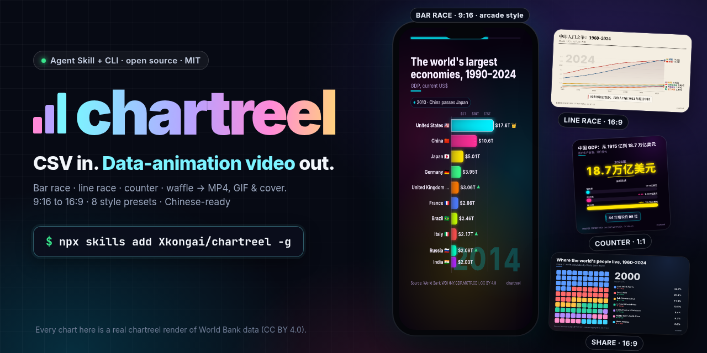
</p>

<h1 align="center">chartreel</h1>

<p align="center">
  <b>Uma Agent Skill + CLI que transforma um CSV em um vídeo curto de dados animados com números exatos.</b><br>
  Corrida de barras, corrida de linhas, contador de números grandes e mudança de participação — MP4 + GIF + capa, 9:16 ou 16:9, com suporte a chinês.
</p>

<p align="center">
  <a href="https://github.com/Xkongai/chartreel/actions/workflows/ci.yml"></a>
  <a href="LICENSE"></a>
  
  
</p>

<p align="center">
  <a href="README.md">English</a> | <a href="README.zh-CN.md">简体中文</a> | <a href="README.ja.md">日本語</a> | <a href="README.es.md">Español</a> | <b>Português (Brasil)</b> | <a href="README.fr.md">Français</a> | <a href="README.de.md">Deutsch</a> | <a href="README.ko.md">한국어</a> | <a href="README.ru.md">Русский</a>
</p>

Vídeos de dados — "as maiores economias do mundo, 1990–2024", "China x Índia em população" — vão muito bem no
Douyin, Xiaohongshu, YouTube Shorts, Reels e X. Fazer um normalmente exige After Effects, uma assinatura do Flourish ou um
notebook cheio de código matplotlib. O **chartreel** dá ao seu agente de IA uma skill para isso: o agente encontra dados reais,
escreve a história (gancho, momentos-chave, conclusão) e renderiza o clipe pronto. Cada número na tela vem do seu CSV.

> **Peça ao seu agente:** "Faça uma corrida de barras vertical de 15 segundos com as 10 maiores economias desde 1990,
> com dados do Banco Mundial e uma conclusão no final."

## Vitrine

Cada clipe e quadro abaixo é um render real do chartreel com os [exemplos do Banco Mundial](examples/README.md) incluídos (CC BY 4.0), feito com o comando logo abaixo.

### Modelos

| Corrida de barras · 16:9 · `dark` | Corrida de linhas · rótulos em chinês · `paper` |
| --- | --- |
| 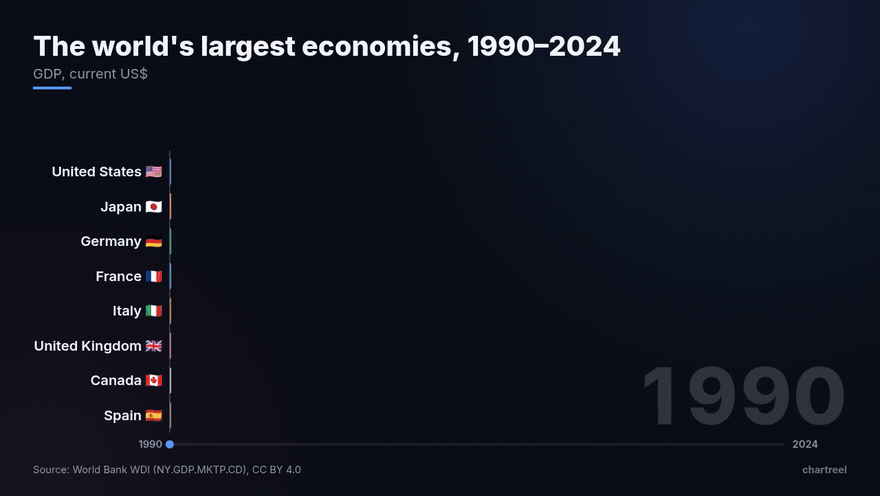 | 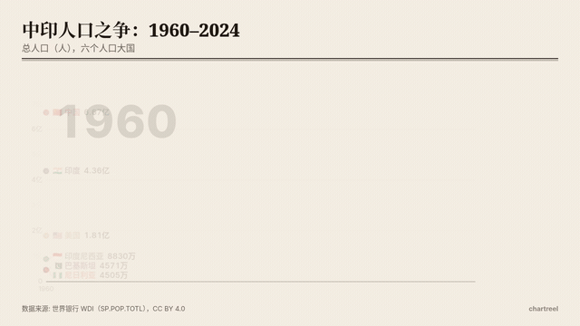 |
| `chartreel render examples/gdp-race.csv -c examples/gdp-race.json -a 16:9 --size 720 -d 7 --intro 0.4 --outro 1.6 --top 8` | `chartreel render examples/population-zh.csv -c examples/population-zh.json -a 16:9 --size 720 -d 8 --outro 1.6` |
| **Contador de número grande · 1:1 · `neon`** | **Mudança de participação (waffle) · 16:9 · `paper`** |
|  | 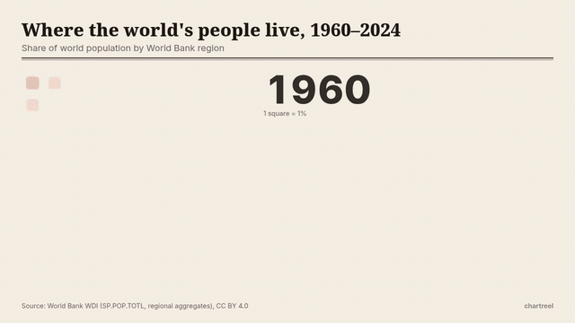 |
| `chartreel render examples/china-gdp-counter.csv -c examples/china-gdp-counter.json -a 1:1 --size 720 -d 7 --outro 1.6` | `chartreel render examples/population-share.csv -c examples/population-share.json --theme paper -a 16:9 --size 720 -d 7 --outro 1.6` |

Capas em tamanho real: [corrida 9:16](docs/cover-race-9x16.png) · [corrida de linhas 16:9](docs/cover-line-16x9.png).

### Estilos prontos (`--style`)

Os mesmos dados, o mesmo vídeo 9:16 de 15 segundos, oito visuais. Cada estilo reúne um tema, um cartão de gancho por ~1,5 s, um contador de ano, o destaque do 1º lugar e efeitos. Os números continuam exatos em todos (`tests/test_styles.py`). As miniaturas são o quadro aos 8,25 s de cada MP4, feito com:

```bash
chartreel render examples/gdp-race.csv -c examples/gdp-race.json -d 15 --style STYLE \
  --hook "Who has the world's biggest economy?" --cta "Follow for more data stories"
# all eight at once: bash scripts/make_styles.sh out/styles
```

<table>
<tr><td width="25%" valign="top">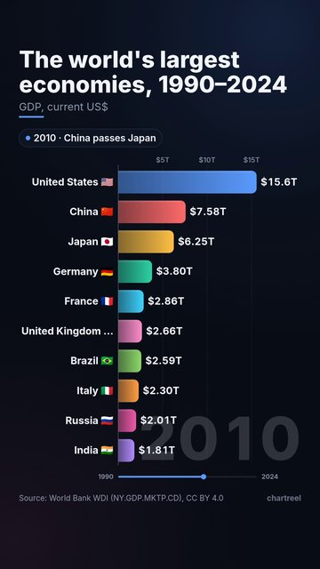<br><b><code>--style classic</code></b><br><sub>Visual padrão, sem gancho (renderizado sem <code>--hook</code>/<code>--cta</code>)</sub></td><td width="25%" valign="top">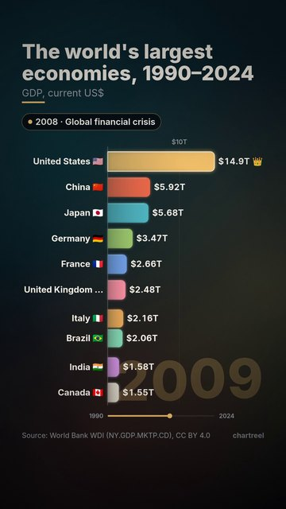<br><b><code>--style cinematic</code></b><br><sub>Gancho com faixas de cinema, brilho dourado, ano rolando, coroa no 1º, zoom de impacto</sub></td><td width="25%" valign="top">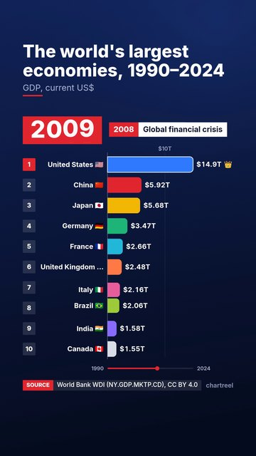<br><b><code>--style news</code></b><br><sub>Tarjas de TV: gancho em tarja, números de posição, ano em selo vermelho, tarja da fonte</sub></td><td width="25%" valign="top">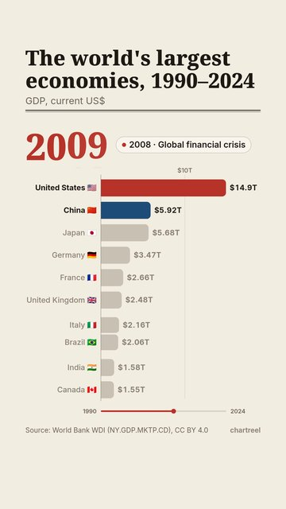<br><b><code>--style editorial</code></b><br><sub>Gancho de máquina de escrever, barras cinza, séries destacadas (mais <code>--highlight "China,United States"</code>)</sub></td></tr>
<tr><td width="25%" valign="top">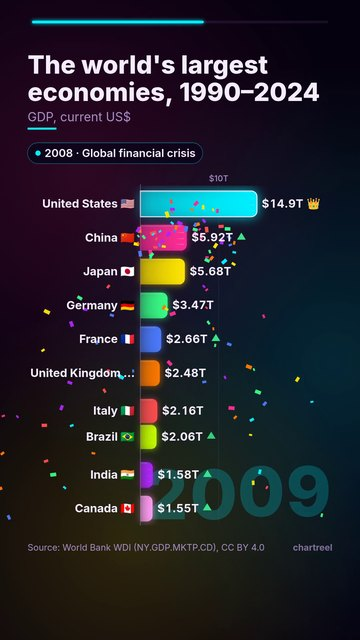<br><b><code>--style arcade</code></b><br><sub>Neon, confete e zoom quando uma barra entra no top 3, setas ▲, rastros de velocidade</sub></td><td width="25%" valign="top">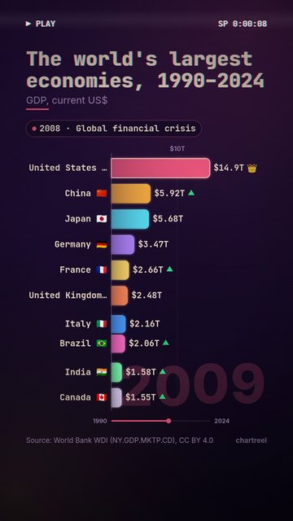<br><b><code>--style retro</code></b><br><sub>Linhas de VHS, texto com aberração cromática, selo PLAY, gancho de máquina de escrever</sub></td><td width="25%" valign="top">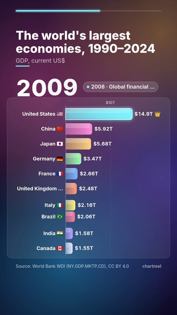<br><b><code>--style glass</code></b><br><sub>Manchas de cor em movimento, painel fosco, barra de progresso no topo</sub></td><td width="25%" valign="top">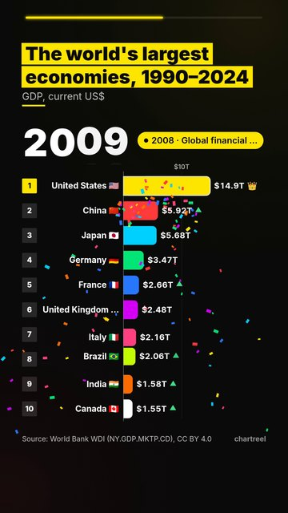<br><b><code>--style bold</code></b><br><sub>Texto grande estilo Douyin: gancho com palavras destacadas, ano enorme, números de posição</sub></td></tr>
</table>

Os oito lado a lado:

<p align="center">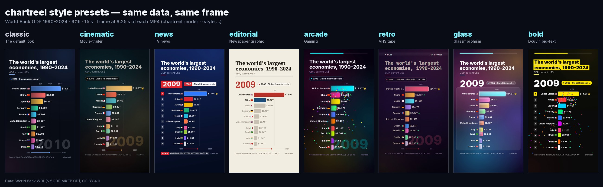</p>

Monte o seu: `--fx bg,vignette,letterbox,scanlines,punch,confetti,trails,arrows,glass`, `--no-fx confetti`, `--year-style roll|row|badge`, `--progress top`, `--hook-style pop|type|strap|bold`. `--audio music.mp3` adiciona uma faixa que seja sua (cortada e com fade; o chartreel não inclui música). `chartreel styles` lista tudo.

## Instalação

Você precisa de Python 3.10+, ffmpeg e Chromium (o Playwright baixa; um Chrome já instalado também funciona).

**1. A CLI**

```bash
pip install "git+https://github.com/Xkongai/chartreel"
python -m playwright install chromium     # skip if Chrome/Chromium is installed
chartreel doctor                          # checks ffmpeg, Chromium and fonts
```

ffmpeg: `brew install ffmpeg` (macOS) · `sudo apt install ffmpeg` (Ubuntu) · `winget install Gyan.FFmpeg` (Windows).
Para texto em chinês, japonês ou coreano no Linux: `sudo apt install fonts-noto-cjk fonts-noto-color-emoji`.

**2. A skill** (escolha seu agente)

| Agente | Instalação |
| --- | --- |
| Claude Code | `/plugin marketplace add Xkongai/chartreel` e depois `/plugin install chartreel@chartreel` |
| Codex | `git clone https://github.com/Xkongai/chartreel && mkdir -p ~/.agents/skills && cp -r chartreel/skills/chartreel ~/.agents/skills/` |
| Cursor, OpenCode, Gemini CLI e outros | `npx skills add Xkongai/chartreel -g` |
| Qualquer agente que leia `SKILL.md` | copie `skills/chartreel/` para a pasta de skills do agente |

O Claude Code também lê `~/.claude/skills/chartreel/` se você preferir copiar a pasta manualmente.

## Início rápido (CLI)

```bash
git clone https://github.com/Xkongai/chartreel && cd chartreel
chartreel render examples/gdp-race.csv -c examples/gdp-race.json -o out/
# out/gdp-race.mp4   1080×1920 H.264, 12 s
# out/gdp-race.gif   540 px wide
# out/gdp-race-cover.png
```

Ou só com opções:

```bash
chartreel render my.csv --template line --theme paper --aspect 16:9 --duration 15 \
  --title "China vs India" --source "World Bank, CC BY 4.0" --takeaway "India passed China in 2021" \
  --note "2021: India passes China" --locale zh -o out/
```

`chartreel validate my.csv` verifica o arquivo antes e aponta a linha e a coluna exatas de qualquer problema.
`chartreel preview my.csv -o out/` gera um player HTML independente que você pode percorrer no navegador.

## Modelos e temas

| Modelo | Ideal para | CSV |
| --- | --- | --- |
| `race` | rankings ao longo do tempo, ultrapassagens | `year,A,B,C…` |
| `line` | poucas séries crescendo ou se cruzando | `year,A,B,C…` |
| `counter` | um número impactante e depois comparações "×N" | `label,value,note` |
| `share` | partes de um todo mudando (waffle 10×10) | `year,A,B,C…` |

Temas: `dark` (tecnológico escuro), `paper` (jornal, título com serifa), `neon` (brilho).
Proporções: `9:16`, `16:9`, `1:1`, `4:5`, `3:4`. O formato longo `year,name,value` é convertido automaticamente.

Opções da história: `--title` (o gancho), `--subtitle` (unidades), `--note "PERÍODO: texto"` (momentos-chave),
`--takeaway` (cartão final), `--source` (sempre visível). Números: `--prefix $`, `--suffix`, `--decimals`,
`--number-style compact|full|percent`, `--locale zh` (万 / 亿 / 万亿). `label`, `color` e `emoji` por série
ficam em um arquivo de configuração JSON. Lista completa: [skills/chartreel/references/options.md](skills/chartreel/references/options.md).

## Como os números continuam corretos

- No momento em que cada linha aparece na tela, todo valor é igual ao do CSV; entre linhas, é uma interpolação
  linear das duas linhas vizinhas. `tests/test_accuracy.py` verifica isso em todos os exemplos, em várias proporções,
  e confere se o ranking da corrida bate com os dados em cada linha.
- Células vazias no meio são interpoladas e informadas pelo `validate`; nada é preenchido de memória.
- O contador sobe e depois para no valor exato. O waffle sempre tem exatamente 100 células (maior resto).
- A skill orienta o agente a buscar dados de uma fonte primária, calcular as conclusões com código e sempre citar a fonte.

## Como funciona

Cada modelo é uma página HTML independente com um `renderFrame(t)` determinístico — sem relógio do sistema e sem
aleatoriedade —, então o mesmo quadro fica idêntico na pré-visualização do navegador e na exportação. O chartreel controla
o Chromium headless com Playwright, captura cada quadro e envia para o ffmpeg (H.264 `yuv420p`, `+faststart`;
GIF via `palettegen`). Vários processos de navegador renderizam trechos em paralelo (`--jobs`).

Medido em uma máquina Linux de 8 núcleos: uma corrida de 12 s em 1080×1920 (360 quadros) renderiza em cerca de 9 s
com 4 processos (cerca de 27 s com um).

## Limitações

- As fontes vêm do sistema. Sem uma fonte CJK, o texto em chinês aparece como quadrados; o `chartreel doctor` avisa.
  Emojis de bandeiras não aparecem no Windows (a fonte de emojis do sistema não tem bandeiras).
- Não inclui música nem efeitos sonoros (adicione sua faixa com `--audio`) e ainda não há quadros-chave personalizados; o tempo entre linhas é uniforme.
- O modelo `line` fica mais legível com até cerca de 8 séries; o `share`, com até cerca de 10 partes.

## Desenvolvimento

```bash
pip install -e ".[dev]" && python -m playwright install chromium
pytest -q                       # parsing, accuracy, deterministic frames, smoke renders
bash scripts/make_demos.sh      # regenerate docs/*.gif
bash scripts/make_styles.sh out/styles    # the eight style presets, 9:16 15 s MP4 + cover
python scripts/make_gallery.py out/styles # docs/styles/*.jpg and docs/styles-compare.jpg
python scripts/make_banner.py             # docs/banner.png and docs/banner@2x.png
python scripts/fetch_worldbank.py   # re-download the example data
```

Veja [CONTRIBUTING.md](CONTRIBUTING.md) e [CHANGELOG.md](CHANGELOG.md).

## Licença

[MIT](LICENSE) © 2026 Xkongai. Dados de exemplo: Banco Mundial, Indicadores de Desenvolvimento Mundial, CC BY 4.0.
