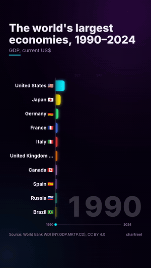

<p align="center">
  
</p>

<h1 align="center">chartreel</h1>

<p align="center">
  <b>Agent Skill + CLI, который превращает CSV в короткое видео с анимацией данных и точными цифрами.</b><br>
  Гонка столбцов, гонка линий, счётчик больших чисел и сдвиг долей — MP4 + GIF + обложка, 9:16 или 16:9, с поддержкой китайского.
</p>

<p align="center">
  <a href="https://github.com/Xkongai/chartreel/actions/workflows/ci.yml"></a>
  <a href="LICENSE"></a>
  
  
</p>

<p align="center">
  <a href="README.md">English</a> | <a href="README.zh-CN.md">简体中文</a> | <a href="README.ja.md">日本語</a> | <a href="README.es.md">Español</a> | <a href="README.pt-BR.md">Português (Brasil)</a> | <a href="README.fr.md">Français</a> | <a href="README.de.md">Deutsch</a> | <a href="README.ko.md">한국어</a> | <b>Русский</b>
</p>

Видео с данными — «крупнейшие экономики мира, 1990–2024», «Китай против Индии: население» — хорошо заходят в
Douyin, Xiaohongshu, YouTube Shorts, Reels и X. Обычно для такого ролика нужен After Effects, подписка Flourish или
ноутбук, полный кода на matplotlib. **chartreel** даёт вашему ИИ-агенту навык для этого: агент находит реальные данные,
пишет сюжет (зацепка, ключевые моменты, вывод) и рендерит готовый клип. Каждое число на экране берётся из вашего CSV.

> **Попросите агента:** «Сделай 15-секундную вертикальную гонку столбцов 10 крупнейших экономик с 1990 года
> по данным Всемирного банка и с выводом в конце».

## Галерея

| Гонка линий (подписи на китайском, `paper`) | Счётчик больших чисел (`neon`) |
| --- | --- |
|  |  |
| **Сдвиг долей (`paper`)** | **Вертикальный 9:16 для Shorts / Douyin (`neon`)** |
|  |  |

Обложки в полном размере: [гонка 9:16](docs/cover-race-9x16.png) · [гонка линий 16:9](docs/cover-line-16x9.png).
Во всех демо используются [данные Всемирного банка (CC BY 4.0)](examples/README.md).

## Установка

Нужны Python 3.10+, ffmpeg и Chromium (его скачивает Playwright; подойдёт и уже установленный Chrome).

**1. CLI**

```bash
pip install "git+https://github.com/Xkongai/chartreel"
python -m playwright install chromium     # skip if Chrome/Chromium is installed
chartreel doctor                          # checks ffmpeg, Chromium and fonts
```

ffmpeg: `brew install ffmpeg` (macOS) · `sudo apt install ffmpeg` (Ubuntu) · `winget install Gyan.FFmpeg` (Windows).
Для китайского, японского и корейского текста в Linux: `sudo apt install fonts-noto-cjk fonts-noto-color-emoji`.

**2. Навык** (выберите своего агента)

| Агент | Установка |
| --- | --- |
| Claude Code | `/plugin marketplace add Xkongai/chartreel`, затем `/plugin install chartreel@chartreel` |
| Codex | `git clone https://github.com/Xkongai/chartreel && mkdir -p ~/.agents/skills && cp -r chartreel/skills/chartreel ~/.agents/skills/` |
| Cursor, OpenCode, Gemini CLI и другие | `npx skills add Xkongai/chartreel -g` |
| Любой агент, читающий `SKILL.md` | скопируйте `skills/chartreel/` в папку навыков агента |

Claude Code также читает `~/.claude/skills/chartreel/`, если вы предпочитаете скопировать папку вручную.

## Быстрый старт (CLI)

```bash
git clone https://github.com/Xkongai/chartreel && cd chartreel
chartreel render examples/gdp-race.csv -c examples/gdp-race.json -o out/
# out/gdp-race.mp4   1080×1920 H.264, 12 s
# out/gdp-race.gif   540 px wide
# out/gdp-race-cover.png
```

Или только с флагами:

```bash
chartreel render my.csv --template line --theme paper --aspect 16:9 --duration 15 \
  --title "China vs India" --source "World Bank, CC BY 4.0" --takeaway "India passed China in 2021" \
  --note "2021: India passes China" --locale zh -o out/
```

`chartreel validate my.csv` сначала проверяет файл и указывает точную строку и столбец любой ошибки.
`chartreel preview my.csv -o out/` создаёт самостоятельный HTML-плеер, который можно перематывать в браузере.

## Шаблоны и темы

| Шаблон | Для чего | CSV |
| --- | --- | --- |
| `race` | рейтинги во времени, обгоны | `year,A,B,C…` |
| `line` | несколько рядов, которые растут или пересекаются | `year,A,B,C…` |
| `counter` | одно большое число, затем сравнения «×N» | `label,value,note` |
| `share` | изменение долей целого (вафля 10×10) | `year,A,B,C…` |

Темы: `dark` (тёмный техно), `paper` (газета, заголовок с засечками), `neon` (свечение).
Форматы кадра: `9:16`, `16:9`, `1:1`, `4:5`, `3:4`. Длинный формат `year,name,value` преобразуется автоматически.

Параметры сюжета: `--title` (зацепка), `--subtitle` (единицы), `--note "ПЕРИОД: текст"` (ключевые моменты),
`--takeaway` (финальная карточка), `--source` (показывается всегда). Числа: `--prefix $`, `--suffix`, `--decimals`,
`--number-style compact|full|percent`, `--locale zh` (万 / 亿 / 万亿). `label`, `color` и `emoji` для каждого ряда
задаются в JSON-конфиге. Полный список: [skills/chartreel/references/options.md](skills/chartreel/references/options.md).

## Почему цифрам можно верить

- В момент, когда строка на экране, каждое значение равно значению из CSV; между строками — линейная интерполяция
  двух соседних строк. `tests/test_accuracy.py` проверяет это для каждого примера в нескольких форматах кадра и сверяет,
  что порядок в гонке совпадает с данными в каждой строке.
- Пустые ячейки в середине интерполируются, и `validate` сообщает о них; ничего не дописывается «по памяти».
- Счётчик досчитывает и останавливается на точном значении. В вафле всегда ровно 100 клеток (метод наибольшего остатка).
- Навык требует от агента брать данные из первоисточника, считать выводы кодом и всегда указывать источник.

## Как это работает

Каждый шаблон — самостоятельная HTML-страница с детерминированной функцией `renderFrame(t)`: без системных часов и
случайности, поэтому один и тот же кадр одинаково выглядит в превью браузера и при экспорте. chartreel управляет
headless Chromium через Playwright, снимает каждый кадр и передаёт его в ffmpeg (H.264 `yuv420p`, `+faststart`;
GIF через `palettegen`). Несколько процессов браузера рендерят участки параллельно (`--jobs`).

Замер на 8-ядерной Linux-машине: 12-секундная гонка 1080×1920 (360 кадров) рендерится примерно за 9 с
с 4 процессами (примерно за 27 с с одним).

## Ограничения

- Шрифты берутся из системы. Без CJK-шрифта китайский текст отображается квадратиками; `chartreel doctor` предупредит.
  Эмодзи флагов не отображаются в Windows (в системном шрифте эмодзи нет флагов).
- Пока нет звуковой дорожки и собственных ключевых кадров; время между строками одинаковое.
- Шаблон `line` хорошо читается примерно до 8 рядов, `share` — примерно до 10 частей.

## Разработка

```bash
pip install -e ".[dev]" && python -m playwright install chromium
pytest -q                       # parsing, accuracy, deterministic frames, smoke renders
bash scripts/make_demos.sh      # regenerate docs/*.gif
python scripts/fetch_worldbank.py   # re-download the example data
```

См. [CONTRIBUTING.md](CONTRIBUTING.md) и [CHANGELOG.md](CHANGELOG.md).

## Лицензия

[MIT](LICENSE) © 2026 Xkongai. Данные примеров: Всемирный банк, World Development Indicators, CC BY 4.0.
